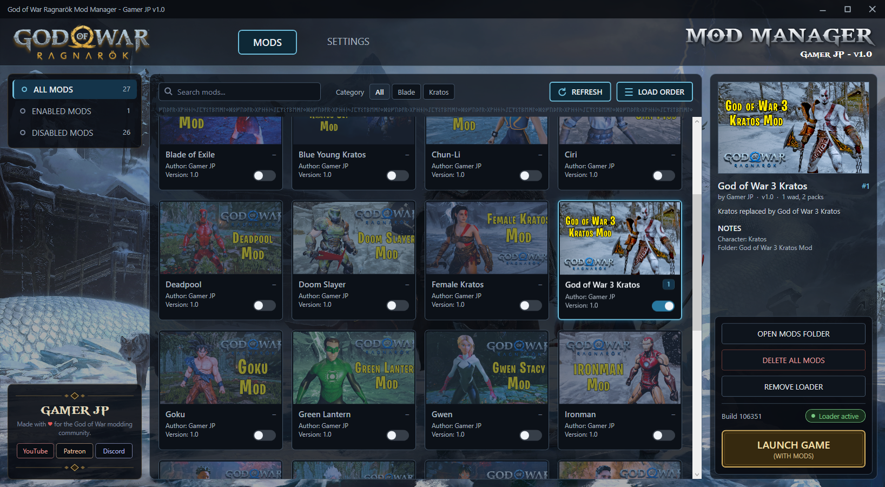
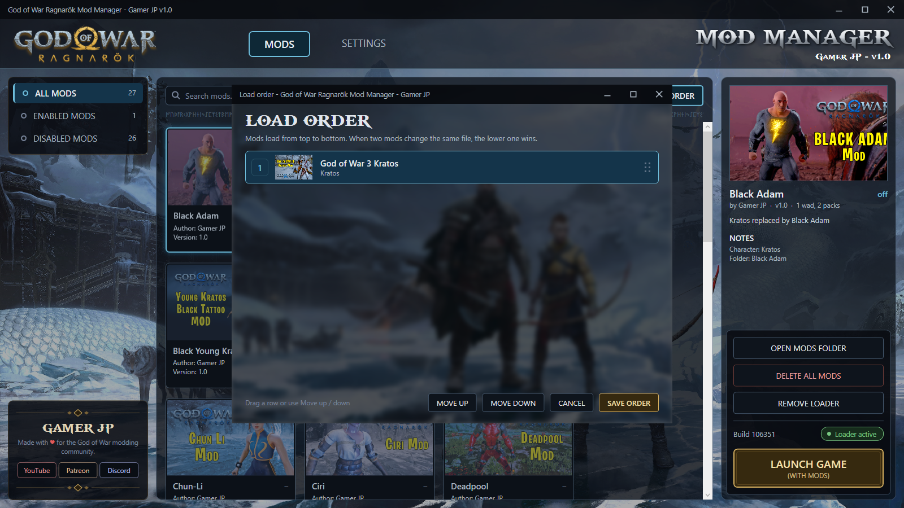
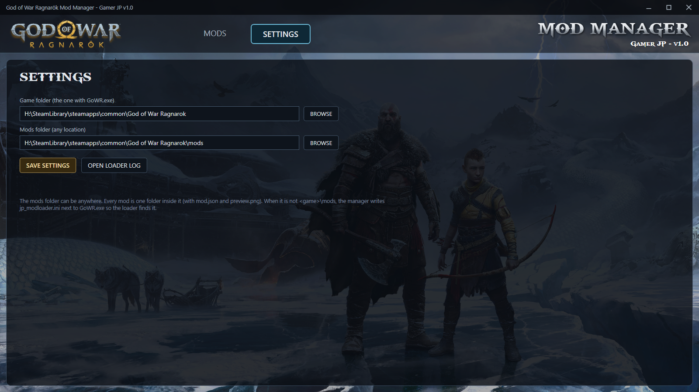
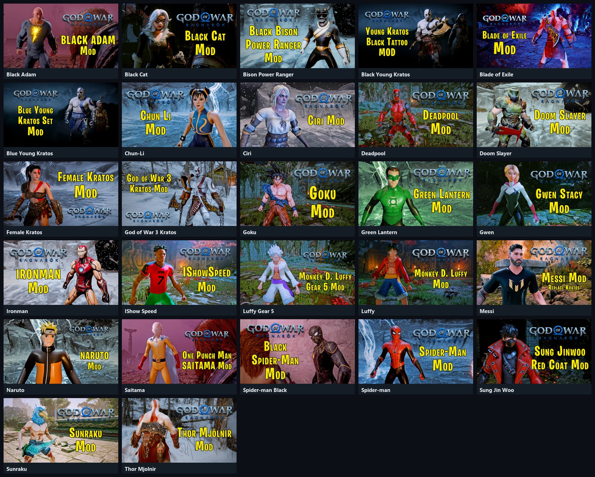

<p align="center">
  
</p>

<h1 align="center">God of War Ragnarök Mod Manager</h1>

<p align="center">
  <b>by Gamer JP · v1.0</b><br>
  Install, enable, disable and order your God of War Ragnarök mods in one click,<br>
  without replacing a single game file.
</p>

<p align="center">
  <a href="https://www.youtube.com/@jpthehero">YouTube</a> ·
  <a href="https://www.patreon.com/c/gamerjp">Patreon</a> ·
  <a href="https://discord.gg/uBTutBA8VX">Discord</a>
</p>

---



## Contents

- [What it is](#what-it-is)
- [Features](#features)
- [Requirements](#requirements)
- [Install](#install)
- [Using the mod manager](#using-the-mod-manager)
- [Adding mods](#adding-mods)
- [mod.json](#modjson)
- [Load order and conflicts](#load-order-and-conflicts)
- [Settings](#settings)
- [How the loader works](#how-the-loader-works)
- [Uninstall](#uninstall)
- [Troubleshooting](#troubleshooting)
- [FAQ](#faq)
- [My mods](#my-mods)
- [Building from source](#building-from-source)
- [Credits and disclaimer](#credits-and-disclaimer)

---

## What it is

God of War Ragnarök (PC) loads character mods by replacing its own `.wad` files and listing extra
texture / geometry packs in `exec\boot-options.json`. Installing mods that way means overwriting game
files, keeping backups and editing JSON by hand, and two mods can quietly break each other.

The **God of War Ragnarök Mod Manager** fixes that:

- A small **mod loader** (`version.dll`, built into the manager) is loaded by the game at start and hands
  the game your mod files **instead of** the original ones. **No game file is ever changed.**
- The **mod manager** shows every mod as a card with its preview, lets you switch mods on and off,
  set the load order and launch the game.

Everything ships as **one exe**.

## Features

- **Single exe**: the loader, artwork and fonts are all inside `God of War Ragnarok Mod Manager.exe`.
- **No game files touched**: mods are served from your mods folder while the game runs. Remove the
  loader and the game is 100% vanilla again.
- **Mod cards** with preview image, name, author, version and an on/off switch.
- **Load order window**: drag the mods into order. The number on every card shows its place.
- **Conflict warnings** when two enabled mods replace the same `.wad` (the later one in the load
  order wins).
- **Search and categories**: filter by name or by character (Kratos, Freya, ...).
- **All / Enabled / Disabled** views.
- **Mods folder anywhere**: keep your mods on any drive, set it once in Settings.
- **Works with older mods**: mods made for the classic "replace the wad + edit boot-options.json"
  install work as they are (see [Adding mods](#adding-mods)).
- **One-click loader**: install, update or remove the loader from the app.
- **Launch game (with mods)** straight from the manager.

## Requirements

| | |
|---|---|
| Game | God of War Ragnarök for PC (Steam). Tested on build **106351**. |
| OS | Windows 10 or 11, 64-bit |
| Runtime | Nothing to install (uses the .NET Framework 4 that comes with Windows) |

> Mods that contain `.wad` files only work on the game build they were made for. After a game update,
> check with the mod author for an updated version.

## Install

1. Download **`God of War Ragnarok Mod Manager.exe`**.
2. Put it in your game folder, next to `GoWR.exe`
   (for example `...\steamapps\common\God of War Ragnarok\`).
   It also works from anywhere else: choose the game folder once in **Settings**.
3. Start it and click **INSTALL LOADER** (right panel). The status turns to **Loader active**.
4. Put your mods into the `mods` folder (click **OPEN MODS FOLDER**), press **REFRESH**,
   switch on the mods you want and press **LAUNCH GAME**.

> Already installed mods the old way (replaced wads / edited `boot-options.json`)? Run
> **Steam → God of War Ragnarök → Properties → Installed Files → Verify integrity of game files**
> first, so the game starts from its original files and the loader handles the mods.

## Using the mod manager


| Area | What it does |
|---|---|
| **MODS / SETTINGS** | Switch between your mod library and the settings. |
| **ALL / ENABLED / DISABLED MODS** | Filter the library. The numbers show how many mods are in each view. |
| **Search mods** | Find a mod by name, character, author or folder. |
| **Category** | Show only the mods for one character (taken from `mod.json`). |
| **REFRESH** | Re-read the mods folder after you add, remove or edit mods. |
| **LOAD ORDER** | Open the load order window. |
| **Mod card** | Click to select. The switch turns the mod on or off. The small number is its load order. |
| **Right panel** | Preview, author, version, file count, description and notes of the selected mod. |
| **OPEN MODS FOLDER** | Opens your mods folder in Explorer. |
| **DELETE ALL MODS** | Deletes every mod folder permanently (asks first). |
| **INSTALL / UPDATE / REMOVE LOADER** | Puts the loader next to `GoWR.exe`, updates it, or removes it. |
| **Build / loader status** | Your game build and whether the loader is active. |
| **LAUNCH GAME (WITH MODS)** | Saves everything and starts the game through Steam. |

Every change (switching a mod, the load order) is saved immediately to `mods\loader.ini`.

## Adding mods

A mod is **one folder** inside your mods folder. The folder uses the same layout as the game folder:

```
mods\
└── Spider-man\
    ├── mod.json                     name, author, version ... (optional)
    ├── preview.png                  card image (optional, 16:9 looks best)
    └── exec\
        ├── boot-options.json        optional: its texpack / lodpack lists are merged
        ├── wad\pc_le\
        │   └── r_heroa00.wad        replaces the game's Kratos wad
        └── patch\pc_le\
            ├── Spiderman.lodpack    (+ .lodpack.toc)
            └── SpidermanR.texpack   (+ .texpack.toc)
```

Packaged mods with this layout also work as they are:

```
mods\SomeMod\
├── mod.json
├── preview.png
├── wad\r_freyavalkyrie00.wad        -> exec\wad\pc_le\
├── SomeMod.texpack (+ .toc)         -> added to the game's texpack list
└── SomeMod.lodpack (+ .toc)
```

The loader picks up `.texpack` / `.lodpack` files by itself and adds them to the game's pack list,
so you never edit `boot-options.json`.

> **Pack names:** the game cuts the pack path `../../patch/<folder>/<name>` after 31 characters.
> Keep `<folder>` + `<name>` short (for example `JP/Deadpool`).

## mod.json

Optional. Without it the folder name is used as the mod name.

```json
{
 "name": "Spider-man",
 "character": "Kratos",
 "author": "Gamer JP",
 "version": "1.0",
 "description": "Kratos replaced by Spider-Man"
}
```

| Field | Shown in the manager |
|---|---|
| `name` | Card title, right panel, load order window |
| `character` | **Category** filter and Notes. Keep it filled in. |
| `author` | "Author" on the card, "by ..." in the right panel |
| `version` | "Version" on the card, "v..." in the right panel |
| `description` | Text under the preview in the right panel |

Use straight double quotes and no comma after the last field.

## Load order and conflicts



- Mods load **from top to bottom**.
- When two mods replace the **same file** (for example both replace Kratos `r_heroa00.wad`), the
  **lower** one wins. The manager shows a warning under the mod cards, and the load order window
  marks those mods with **conflict**.
- Drag a row, or select it and use **MOVE UP / MOVE DOWN**, then **SAVE ORDER**.

## Settings



| Setting | |
|---|---|
| **Game folder** | The folder with `GoWR.exe`. Found automatically when the manager sits in the game folder. |
| **Mods folder** | Any folder on any drive. Default: `<game>\mods`. |
| **OPEN LOADER LOG** | Opens `mods\_loader\log.txt`: which mods were loaded and every file the game was given. |

**BROWSE** opens the normal Windows folder picker (This PC, Quick access, address bar).

When the mods folder is not `<game>\mods`, the manager writes a small `jp_modloader.ini` next to
`GoWR.exe` so the loader knows where to look. Settings are kept in `%APPDATA%\GoWR Mod Manager\`.

## How the loader works

```
GoWR.exe starts
   └─ loads version.dll from the game folder (the JP mod loader)
        ├─ reads mods\loader.ini         which mods are on, in which order
        ├─ maps every file of every enabled mod to the game path it replaces
        ├─ builds a merged boot-options.json   the game's own file + every mod's texpack / lodpack
        └─ when the game opens a file:   a mod has it  -> the game gets the mod's copy
                                         no mod has it -> the game gets its own file
```

- The loader passes the real `version.dll` functions through to Windows, so the game works exactly as
  before.
- Only **reading** is redirected. The game never writes into your mods, and **no game file is modified**.
- The log (`mods\_loader\log.txt`) lists every redirected file, which makes problems easy to find.

## Uninstall

- **Play without mods:** switch the mods off, or click **REMOVE LOADER**.
- **Remove everything:** click **REMOVE LOADER**, then delete the manager exe and your mods folder.
  Because no game file was changed, the game is vanilla immediately.

## Troubleshooting

| Problem | Fix |
|---|---|
| A mod does not show in the game | Is the status **Loader active**? Is the mod switched on? Check `mods\_loader\log.txt`. |
| "Loader update" in the status | Click **UPDATE LOADER** (a newer loader is inside the manager). |
| Two mods for the same character | Only the lower one in the load order shows. Switch one off or reorder. |
| Game crashes after a game update | Wad mods are tied to the game build. Switch them off and ask the mod author for an update. |
| Mods were installed the old way before | Verify the game files in Steam, then use the manager. |
| Antivirus / SmartScreen warning | The exe and loader are not code-signed. Allow them, or build them yourself from source. |
| Card has no image / wrong name | Add `preview.png` and `mod.json` to the mod folder and press **REFRESH**. |

## FAQ

**Does it change my game files?**
No. The loader serves the mod files while the game runs. Remove the loader and the game is vanilla.

**Can I keep my mods on another drive?**
Yes. Set the mods folder in **Settings**.

**Do old mods work?**
Yes. Mods that shipped a replaced `.wad` and a `boot-options.json` work as they are: copy the mod
folder into your mods folder.

**Why is the loader called `version.dll`?**
The game loads `version.dll` from its own folder at start. That is how the loader gets in without
changing `GoWR.exe`.

**Is it safe online?**
God of War Ragnarök's main game is single-player. Use mods at your own risk.

## My mods

Some of my God of War Ragnarök mods, all running through the mod manager:



Videos, new mods and tutorials: **[YouTube](https://www.youtube.com/@jpthehero)** ·
support me on **[Patreon](https://www.patreon.com/c/gamerjp)** ·
join the **[Discord](https://discord.gg/uBTutBA8VX)**.

## Building from source

| Part | Source | Build |
|---|---|---|
| Mod loader (`version.dll`) | `loader/src/jp_loader.cpp` (C++, Windows API only) | `loader/build.bat` (Visual Studio 2022, x64) |
| Mod manager (exe) | `loader/manager_wpf/ModManager.cs` (C# / WPF, .NET Framework 4) | `loader/manager_wpf/build.bat` |

`manager_wpf/build.bat` builds the loader first, then the manager with the loader, background, logo
and font embedded. A self-test for the loader is in `loader/test/run_test.ps1`.

## Credits and disclaimer

- **God of War Ragnarök Mod Manager** and the **JP mod loader** by **Gamer JP**.
  Made with ♥ for the God of War modding community.
- God of War and God of War Ragnarök are trademarks of Sony Interactive Entertainment LLC. The logo,
  artwork and font used in the app belong to their owners. This is a free, unofficial fan tool and is
  not affiliated with or endorsed by Sony Interactive Entertainment or Santa Monica Studio.
- Mods are made by their authors. Use mods at your own risk and keep backups of your saves.
